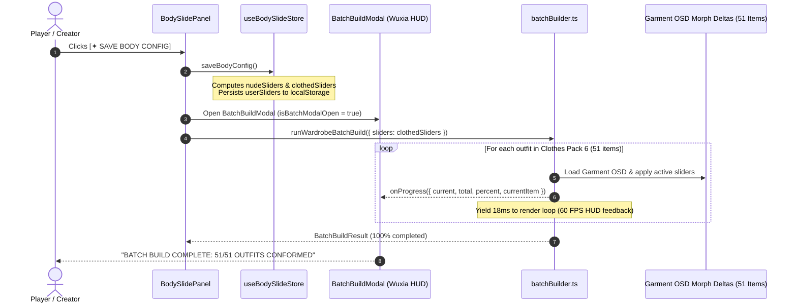

# BodySlide & 0NecocoSliders Architecture Rules

Whenever developing, extending, or maintaining BodySlide sliders, UBE morph targets, or preset synchronization in this repository, all agents must strictly follow these mandatory rules:

---

### 1. File Format & Asset Source Contracts
- **Binary Morph Data (`.osd`)**:
  - Staged under `public/assets/bodyslide/UBE SE 2.0 - Necoco Body.osd`.
  - Format signature: `\0DSO` (0x00, 0x44, 0x53, 0x4F), Version uint32 (1), Block Count uint32 (236).
  - Sparse diff format: `[vIdx: uint16, dx: float32, dy: float32, dz: float32]` (14 bytes per vertex delta).
  - Vertex indices map strictly to the canonical UBE 2.0 body vertex count ($\le 32,512$ vertices).
- **SliderSet Mapping (`.osp`)**:
  - Maps slider names (e.g. `Necoco_Boob_Base`, `BreastsBigger`) to their corresponding OSD target blocks.
- **Categories (`0NecocoSliders.xml`)**:
  - The 7 canonical BodySlide categories must be preserved in UI:
    1. `1 - Necoco Boob`
    2. `2 - Necoco Sliders Overall`
    3. `3 - Necoco Body (Use this for Customizing)`
    4. `4 - Necoco Body Addons (Use with Necoco Body)`
    5. `5 - Necoco Sliders Other`
    6. `Burger Sliders`
    7. `Xtrem Sliders`
- **Presets (`.xml`)**:
  - Full compatibility with Bethesda Creation Engine / BodySlide XML format (`<Preset name="..." set="..."><SetSlider name="..." value="..."/></Preset>`).

---

### 2. Coordinate Transformation Standard
When translating Skyrim NIF units to Three.js render frame, always apply the exact scale and axes swap:
- `render_X = nif_X * 0.01288`
- `render_Y = nif_Z * 0.01288` *(Skyrim Z-up maps to Three.js Y-up)*
- `render_Z = nif_Y * 0.01288` *(Skyrim Y-forward maps to Three.js Z-forward)*

Never guess or invert axes inconsistently across mesh parts.

---

### 3. Non-Destructive Morph Buffer Pipeline
- **Base Geometry Preservation**:
  - Never mutate the canonical base mesh positions permanently.
  - Always cache the un-morphed vertex positions in `bodyBasePositionsRef`.
  - On slider change, accumulate deltas onto the active position buffer from the cached base:
    $$\vec{P}_{\text{active}}[i] = \vec{P}_{\text{base}}[i] + \sum_{s} \frac{\text{weight}_s}{100} \cdot \Delta\vec{v}_{s}[i]$$
- **Normals & Lighting**:
  - Call `geometry.computeVertexNormals()` immediately after position updates to prevent faceted lighting or lighting artifacts.
- **Performance Floor**:
  - Accumulation must execute in $< 1.0\text{ms}$ to maintain 60 FPS viewport smoothness during interactive slider dragging.

---

### 4. UI/UX Standards & Wuxia HUD Integration
- **Sub-Navigation Split**:
  - The Body Panel must maintain a clear top toggle: `[BODYSLIDE (0NECOCO)]` for high-poly vertex morphs, and `[SKELETON SCALE]` for skeletal bone scaling.
- **Accordion Hygiene**:
  - Collapsible accordions with clean status indicators (open/closed arrows, active count).
  - Search filter input at top to filter across all 84 sliders instantly.
  - Double-click on any slider or value badge resets it to its default authored value.
- **Clean Canvas & No Scrollbars**:
  - Zero visible scrollbars (`scrollbar-none`) on all BodySlide panels while preserving smooth mouse-wheel and touch scrolling.
  - Typography floor $\ge 10\text{px}$; hit target floor $\ge 24\text{px}$.

---

### 5. Automated Verification Standard
Every change to BodySlide modules must pass all automated verification checks before committing:
- `npm run typecheck` (`tsc --noEmit`) with 0 errors.
- `npm run check:editor` (Editor AST routing & picker coverage).
- `npm run check:hair` (Hair thumbnails & bounding).
- `npm run check:selection` (Asset catalogue & pack selection).

---

### 6. Unified Baseline Architecture & Background Dual-Preset Synchronization
'UBE Necoco for Converting Outfits' is the single canonical baseline preset for both bare anatomy (`femalebody_0.nif` / `femalebody_1.nif`) and wardrobe layers (`outfit_0.nif` / `outfit_1.nif`). This eliminates anatomical mismatch and ensures seamless 1:1 shape alignment between the naked body and clothed meshes.

```
                    ┌───────────────────────────────────┐
                    │      Wuxia BodySlide Sliders      │
                    │         (userSliders)             │
                    └─────────────────┬─────────────────┘
                                      │
                         computeDualSliders(...)
                                      │
            ┌─────────────────────────┴─────────────────────────┐
            ▼                                                   ▼
┌───────────────────────────────────────────────┐   ┌───────────────────────────────────────────────┐
│                  nudeSliders                  │   │                clothedSliders                 │
│      (Base: UBE Necoco Converting Outfits)    │   │      (Base: UBE Necoco Converting Outfits)    │
│  Deforms femalebody_0 / _1 (Anatomy Baseline) │   │  Deforms outfit_0 / _1 (Anti-Clipping Clamped)│
└───────────────────────────────────────────────┘   └───────────────────────────────────────────────┘
```

1. **Unified Baseline**:
   - Both `NUDE_BASE_SLIDERS` and `CLOTHED_BASE_SLIDERS` are anchored by `UBE Necoco for Converting Outfits` (master 211 morph slider preset).
   - `DEFAULT_NECOCO_SLIDERS`: Aliases `CONVERTING_OUTFITS_SLIDERS` as the single canonical store baseline.
   - `NUDE_BASE_SLIDERS`: Exact replica of `CONVERTING_OUTFITS_SLIDERS`.
   - `CLOTHED_BASE_SLIDERS`: Anchored by `CONVERTING_OUTFITS_SLIDERS` with fabric anti-clipping sanitizer clamps (`NipplesShowUp: 0`, `AreolaErection: 0`).
   - User slider adjustments (`userSliders`) dynamically apply on top of this unified baseline via `computeDualSliders(userSliders)`.

---

### 7. Bidirectional Cross-Mapping Engine & Anti-Clipping Sanitizer
`0NecocoSliders.xml` authors sliders with `Necoco_` prefixes, whereas wardrobe meshes (`Clothes Pack 6 UBE.osp`) author morph targets using standard UBE / CBBE naming conventions. The dual engine dynamically cross-maps values:

#### A. Cross-Mapping Matrix
| User / Necoco Slider | Target Outfit Morph | Scale / Formula | Purpose |
| :--- | :--- | :--- | :--- |
| `Necoco_Overall_Boob` ($V$) | `BreastsBigger`<br/>`BiggerBreasts_ForOutfits` | $+ (V \times 0.70)$<br/>$+ (V \times 0.80)$ | Primary breast volume expansion on cloth |
| `Necoco_Boob_Base` ($V$) | `BreastsBigger` | $+ ((V - 100) \times 0.40)$ | Base breast cup scaling |
| `Necoco_Boob_Distance` ($V$) | `BreastCenterGapWidth n\|p` | $= V$ | Cleavage separation and cup spacing |
| `Necoco_Body_Addon_Belly` ($V$) | `BellyFatty`<br/>`BiggerBelly_ForOutfits` | $+ ((V - 100) \times 0.50)$<br/>$= (V - 100) \times 0.50$ | Tummy and abdomen volume |
| `Necoco_Body_Addon_Butt` ($V$) | `GluteSize p\|n`<br/>`BiggerButt_ForOutfits` | $+ ((V - 100) \times 0.50)$<br/>$= (V - 100) \times 0.50$ | Glute curvature and projection |
| `Necoco_Body_Addon_Leg` ($V$) | `UpperThighsSizeBig`<br/>`BiggerThighs_ForOutfits` | $+ ((V - 100) \times 0.60)$<br/>$= (V - 100) \times 0.50$ | Upper thigh girth and fullness |
| `Upper_Outer_Thighs_Width` ($V$) | `Upper_Outer_Thighs_Width`<br/>`BiggerHips_ForOutfits` | $= V$<br/>$= V \times 0.50$ | Hip flare and outer pelvis width |

#### B. Anti-Clipping Sanitizer Standard
Clothing layers automatically clamp anatomical protrusion sliders that cause fabric penetration:
- `NipplesShowUp = 0` (unless explicitly modified by user in custom mode)
- `AreolaErection = 0` (unless explicitly modified by user in custom mode)

This guarantees clothing fabrics remain taut without nipple or areola poke-through.

---

### 8. Skyrim Slot 32 Modular Body Culling & Garment Visibility Rules
In the Creation Engine, equipping an armor occupies Biped Object Slot 32 (Body). If the armor has an embedded body partition, the naked body is culled to prevent z-fighting:

```
[Character Mesh Rendering]
        │
        ├── garmentVisible === true AND hasBodywear?
        │       ├── YES ──► Cull standalone femalebody.nif (prevent z-fighting)
        │       │           Render Outfit mesh + Embedded body partition (morphed with clothedSliders)
        │       │
        │       └── NO  ──► Hide Embedded body partition (hideEmbeddedBody = true)
        │                   Un-cull canonical 32,512-vertex femalebody.nif (morphed with nudeSliders)
        │                   Result: Gapless, seamless naked body from neck to toes
```

- **`hasBodywear` Definition**:
  ```ts
  const hasBodywear = garmentVisible !== false && equipped.some(isTorsoGarment);
  ```
- **Embedded Body Partition Flag**:
  ```tsx
  <EquippedGarment
    part={garment}
    hideEmbeddedBody={!hasBodywear || garmentVisible === false}
  />
  ```
- **Anatomy Mode Guarantee**: When `garmentVisible === false`, `hideEmbeddedBody` is forced to `true` and `hasBodywear` evaluates to `false`, ensuring zero groin/pelvis gaps and complete skin texture continuity.

---

### 9. 1-Click `[✦ SAVE BODY CONFIG]` Batch Conforming Pipeline



1. **Trigger**: Player finishes adjusting sliders and clicks `[✦ SAVE BODY CONFIG]`.
2. **Persistence**: `saveBodyConfig()` caches `userSliders` to `localStorage ('cc_user_body_sliders')` and returns computed `clothedSliders`.
3. **Wuxia Modal**: Displays floating HUD modal with gold corner accents, item tracker, percentage readout, and animated progress bar.
4. **Execution**: `runWardrobeBatchBuild()` loops across all 51 wardrobe pieces in `Clothes Pack 6 UBE.osp`, matching target morph blocks against binary `.osd` data.
5. **Frame Budget**: Yields $\approx 18\text{ms}$ per item to maintain a smooth 60 FPS viewport render loop during build.
6. **Result**: Upon completion, all outfits conform to the player's custom body shape with zero clipping on equip.
