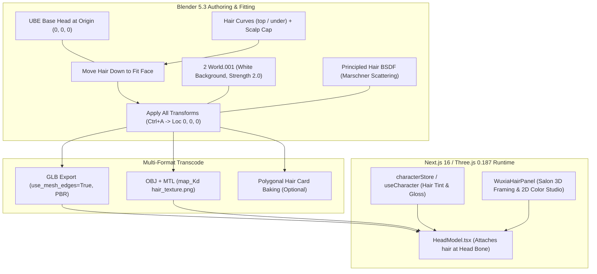

# Hair Asset Standard & Blender-to-App Pipeline

> [!IMPORTANT]
> **Canonical Standard (Head-Local Space)**: 
> * The **Base Head (`FemaleHead`) stays locked at Origin `(0.0, 0.0, 0.0)`**.
> * The **Hair is moved down to fit the Head**, never the head to the hair.
> * All hair objects must have **Transforms Applied** (`Ctrl+A` $\to$ Location, Rotation, Scale = `(0, 0, 0)`) before export so that the exported hair sits natively in Head-Local Space.

---

## 1. Pipeline Overview



---

## 2. Anatomical Reference & Fitting Coordinates (Head-Local Space)

Every hair style must be fitted against the canonical UBE base head mesh at the world origin `(0, 0, 0)`.

### A. Base Mesh Reference
* **File**: `D:\exports\ube_base_femalehead.obj`
* **Location**: **`Fixed at (X: 0.0, Y: 0.0, Z: 0.0)`** (Head-Local Space).
* **Topology**: UBE SE 2.0 / Necoco female head ($11,498$ vertices).
* **Skin Texture Reference**: `public/assets/preset-pack/textures/skin/diamond_head.webp` ($4096 \times 4096$ diffuse) + `diamond_head_n.png` (tangent normal).

### B. Hair Fitting & Transform Application
When importing raw hair styles (which are often positioned at character standing height $Z \approx 1.63\text{m}$):

1. **Move Hair Down to the Face**:
   * Lower the scalp cap and hair curves down by $\Delta Z \approx -1.5524\text{m}$ (and align forward/back $\Delta Y \approx +0.0174\text{m}$).
   * Align fringe/bangs so they fall naturally across the forehead right above the brow ridge.
   * Ensure the skull dome sits flush beneath the hair part with no scalp penetration.
2. **Apply All Transforms (`Ctrl+A`)**:
   * Select the scalp cap (`daisy`) and Hair Curves (`top`, `under`).
   * Apply Location, Rotation, and Scale:
     $$\text{Object Location} \to (0.0, 0.0, 0.0)$$
     $$\text{Object Rotation} \to (0.0^\circ, 0.0^\circ, 0.0^\circ)$$
     $$\text{Object Scale} \to (1.0, 1.0, 1.0)$$
   * This guarantees the hair vertices are stored natively in head-local coordinates, perfectly matching the Skyrim head bone (`NPC Head [Head]`) and Three.js head group.

---

## 3. Blender Shading & Lighting Standard

To preserve the soft, glowing look in Blender's viewport and renders:

1. **Environment Lighting**:
   * **World**: `2 World.001`
   * **Color**: Pure white `RGB(1.0, 1.0, 1.0)`
   * **Strength**: `2.0` (critical for light transmission through fine hair fibers).
2. **Hair Shader**:
   * Node: `Principled Hair BSDF` (Marschner scattering model).
   * Base Auburn Hair Color: `RGB(0.177887, 0.064803, 0.027321)` (`#73412B`).
   * Melanin: `0.80`, Roughness: `0.40`.

---

## 4. Export Specifications for the App

### A. WebGL Runtime (`cc-kit-react`)
* **Format**: GLB 2.0 binary (`D:/exports/daisy_hair.glb`).
* **Location**: Centered at Origin `(0, 0, 0)` in Head-Local Space.
* **Bounding Box**: $X \in [-0.076, +0.076]\text{m}$, $Z \in [-0.118, +0.064]\text{m}$.
* **Export Flags**:
  ```python
  bpy.ops.export_scene.gltf(
      filepath="D:/exports/daisy_hair.glb",
      use_selection=True,
      export_format='GLB',
      use_mesh_edges=True,
      export_apply=True
  )
  ```
* **Embedded Texture**: Embedded PNG buffer (`hair_texture.png`) mapped to `Pomiya_Hair_PBR`.

### B. Universal Mesh Fallback
* **Format**: Wavefront OBJ (`D:/exports/daisy_hair.obj` + `daisy_hair.mtl`).
* **Texture Map**: `D:/exports/hair_texture.png` mapped to `map_Kd`.

---

## 5. In-App Preview & Fine-Tuning Workflow

> [!TIP]
> After exporting, preview the hair directly in the app at `http://localhost:3000`:
> 1. In `cc-kit-react`, because the hair origin is now `(0, 0, 0)`, it will snap directly to the character's head bone without any height offsets.
> 2. Open the **Hair Studio** tab to inspect front, profile, and 3/4 angles using the **Salon Camera**.
> 3. Verify hairline blending and test live hair dyeing via the **Wuxia 2D Color Studio**.
> 4. If any vertex adjustments are needed after the live preview, edit the curve radius/groom in Blender, re-apply transforms, and re-export.
